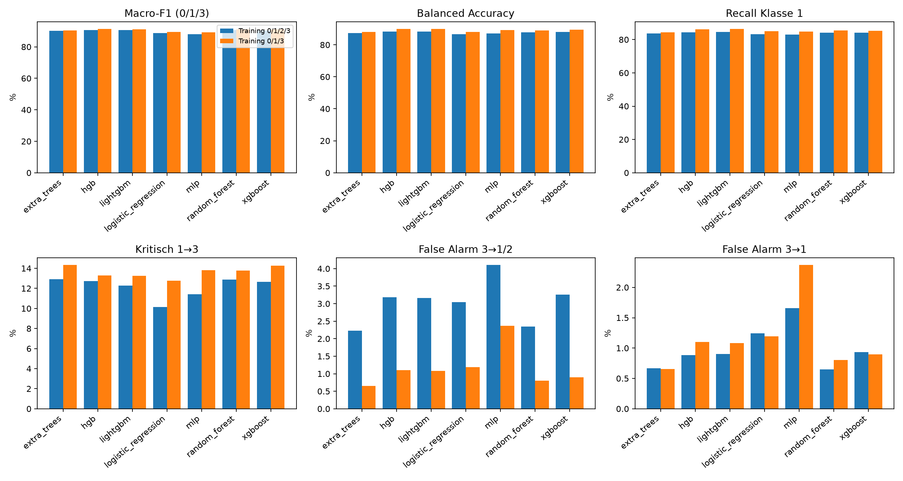
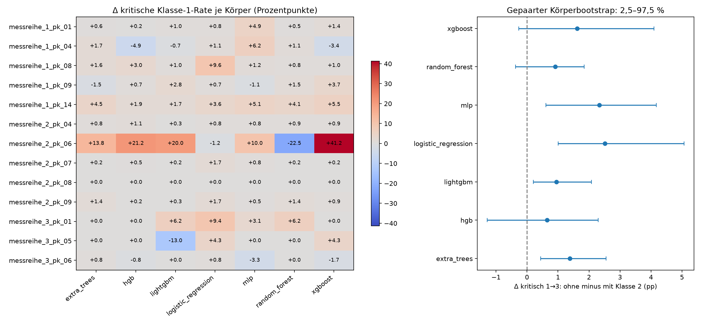

# Einfluss der unsicheren Klasse 2 auf das Training

**Ergebnis:** Das Entfernen von Klasse 2 verbessert die aggregierten 0/1/3-Metriken,
erhöht aber bei **allen sieben Modellen kritische Fehler 1→3**. Eine pauschale
Entfernung ist bei der bisherigen Sicherheitspriorität nicht gerechtfertigt.
Klasse 2 ist zugleich nicht als eigenständige physische Signalpopulation bestätigt.
Es wurden keine Labels geändert und keine Variante in die Produktion übernommen.

## Kontrollierter Vergleich

Verwendet wurden ausschließlich die **23 bisherigen Trainingskörper**, 34.235 Punkte,
die 52 Features aus `early_legacy_windows` und exakt die drei gespeicherten Folds aus
`anchor_group_cv_v1/cohort_folds.csv`. Die unveränderte, per Prüfsumme geprüfte
Featuredatei wurde wiederverwendet; keine neue Extraktion war erforderlich. Der frühe
Marker ist weiterhin ein experimenteller, physikalisch nicht verifizierter Anker.

Je Modell/Fold wurde eine neue Vierklassen- und eine neue Dreiklassenpipeline gefittet:
**42 Fits**, Registry-Konfigurationen und Seed 42 unverändert. Klasse 2 wird im
Dreiklassenarm **vor jeder Imputation, Varianzprüfung, Skalierung und Klassifikator-
Anpassung entfernt**. Für XGBoost werden 0/1/3 reversibel auf 0/1/2 codiert;
Ausgaben und Wahrscheinlichkeitsnamen tragen wieder die ursprünglichen Labels.
Metadaten und Koordinaten werden nicht als Features verwendet.

| OOF-Fold | Ausgeschlossene Körper | OOF-Punkte 0/1/3 | OOF-Punkte 2 | Training mit / ohne 2 |
| --- | ---: | ---: | ---: | ---: |
| 0 | 8 | 11.231 | 744 | 22.260 / 20.701 |
| 1 | 8 | 10.963 | 878 | 22.394 / 20.969 |
| 2 | 7 | 9.738 | 681 | 23.816 / 22.194 |

Alle Vergleiche unten verwenden dieselben **31.932 OOF-Punkte**: 4.553 der Klasse 0,
5.297 der Klasse 1 und 22.082 der Klasse 3. Macro-F1 mittelt ausschließlich über
die Zielklassen 0/1/3. Eine Ausgabe 2 zählt als Fehler und verursacht False Negatives
der tatsächlichen Klasse. Balanced Accuracy ist der mittlere Recall der Zielklassen.
Auf einzelnen Körpern fehlen Klassen: deren Recall/Fehlerrate wird als NaN dokumentiert;
Körper-Macro-F1 verwendet weiterhin die drei festen Zielklassen, Balanced Accuracy
die tatsächlich vertretenen Klassen. Gepoolte und Foldmetriken enthalten alle drei.

Kritisch: **wahre 1→3**, Nenner 5.297. False Alarm: **wahre 3→1/2**, Nenner 22.082;
zusätzlich wird 3→1 separat ausgewiesen. Vollständige 3×4-Konfusionsmatrizen erhalten
die zusätzliche Ausgabe 2. Diese Macro-F1-Werte sind nicht direkt mit dem früheren
Vierklassen-Macro-F1 einschließlich wahrer Klasse 2 vergleichbar.

## Ergebnisse auf bekannten Klassen

Angaben jeweils **Training mit 2 → Training ohne 2**. BA und Recall sind Prozentwerte;
kritische Fehler als Anzahl (Prozent der wahren Klasse 1).

| Modell | Macro-F1 | BA % | Recall 1 % | Kritisch 1→3: n (%) | False Alarms n |
| --- | ---: | ---: | ---: | ---: | ---: |
| Logistic Regression | 0,8882 → 0,8955 | 86,55 → 87,95 | 83,31 → 85,07 | 538 (10,16) → 676 (12,76) | 673 → 263 |
| Random Forest | 0,9074 → 0,9103 | 87,89 → 88,91 | 84,16 → 85,46 | 682 (12,88) → 730 (13,78) | 517 → 177 |
| HGB | 0,9070 → 0,9131 | 88,21 → 89,86 | 84,33 → 86,18 | 675 (12,74) → 704 (13,29) | 702 → 243 |
| XGBoost | 0,9047 → 0,9114 | 87,97 → 89,54 | 84,09 → 85,33 | 670 (12,65) → 756 (14,27) | 720 → 198 |
| LightGBM | 0,9075 → 0,9116 | 88,32 → 89,82 | 84,63 → 86,33 | 650 (12,27) → 701 (13,23) | 698 → 239 |
| Extra Trees | 0,9016 → 0,9031 | 87,41 → 88,07 | 83,71 → 84,44 | 685 (12,93) → 759 (14,33) | 493 → 144 |
| MLP | 0,8797 → 0,8923 | 87,02 → 89,25 | 82,93 → 84,86 | 604 (11,40) → 731 (13,80) | 906 → 523 |

Der höhere Recall 1 widerspricht den zusätzlichen kritischen Fehlern nicht:
Andere Klasse-1-Fehler, insbesondere Ausgaben 2, entfallen. Zugleich enden mehr
Klasse-1-Messungen direkt bei 3. Ein besserer mittlerer Recall bedeutet hier daher
keine sicherere Fehlerverteilung.



**Ausgaberaum als Einflussfaktor:** Vierklassen-Wahrscheinlichkeiten wurden zusätzlich
ohne erneutes Training auf den Argmax aus 0/1/3 beschränkt. Damit wird 2 nicht auf eine
andere Klasse umgelabelt. Bei gleichem Ausgaberaum liegt der Macro-F1 des weiterhin
mit Klasse 2 trainierten Modells bei **vier von sieben Modellen höher** als nach
Entfernung der Klasse-2-Trainingspunkte. Beim HGB dagegen erreicht das Dreiklassenmodell
0,9131 gegenüber 0,9125 und 704 gegenüber 729 kritische Fehler. Der ursprüngliche
Vorteil des nativen Vierklassen-HGB bei kritischen Fehlern ist somit teilweise ein
Effekt seiner zusätzlichen Unsicherheitsausgabe, kein eindeutiger Beleg eines besseren
Trainingssignals durch Klasse 2.

Auch die False-Alarm-Reduktion enthält diesen Effekt: Reine **3→1**-Fehler steigen
ohne Klasse 2 bei RF **143→177**, HGB **195→243**, LightGBM **199→239** und MLP
**366→523**; sie sinken bei LR 274→263, XGBoost 206→198 und Extra Trees 147→144.

## Stabilität und Generalisierung

Balanced Accuracy und Recall 1 steigen in **21/21** Modell/Fold-Paaren, Macro-F1
in **20/21**. Kritische 1→3-Fehler steigen ebenfalls in **20/21**; nur HGB/Fold 0
verbessert sich geringfügig. False Alarms sinken in 20/21 Paaren.

Auf den 13 Körpern mit Klasse 1 steigt die kritische Rate pro Modell auf **8–11
Körpern**. Beispiel HGB: `messreihe_2_pk_06` **18/80→35/80**, `messreihe_1_pk_08`
**30/728→52/728**, aber `messreihe_1_pk_04` verbessert sich **124/708→89/708**.
Ein gepaarter Bootstrap über alle 23 Körper (2.000 Ziehungen, Seed 42) zeigt breite
Spannen: HGB-Änderung kritisch −1,29 bis +2,29 Prozentpunkte; bei LR +1,01 bis +5,07.
Das sind bedingte Streuungsintervalle der festen OOF-Vorhersagen, keine erneuten
Trainingsreplikationen oder bestätigenden Signifikanztests.



**Messreihe 3 bleibt besonders problematisch:** Unter ihren nur 176 Klasse-1-Punkten
liegen kritische Fehlerraten beider Arme je nach Modell zwischen **78,4 und 95,5 %**.
Der gepoolte Durchschnitt verdeckt diese Schwäche. Entfernen von Klasse 2 beseitigt
sie nicht. Kleine Supports und unbekannte physische Identität zwischen Messreihen
begrenzen Aussagen über neue Objekte zusätzlich.

## Was geschieht mit den ausgeschlossenen Klasse-2-Punkten?

Alle **2.303 Punkte aus 21 Körpern** werden ausschließlich durch Modelle vorhergesagt,
die deren gesamten Körper im jeweiligen Fold nicht gesehen haben. Die Tabelle zeigt
Anteile der ausgegebenen Klassen; alle Wahrscheinlichkeiten sind **unkalibriert**.

| Dreiklassenmodell | →0 % | →1 % | →3 % | Mittleres p(1) | Mittleres p(3) |
| --- | ---: | ---: | ---: | ---: | ---: |
| Logistic Regression | 6,60 | 13,24 | 80,16 | 0,172 | 0,731 |
| Random Forest | 7,47 | 14,50 | 78,03 | 0,170 | 0,687 |
| HGB | 7,64 | 11,90 | 80,46 | 0,133 | 0,781 |
| XGBoost | 7,60 | 11,29 | 81,11 | 0,123 | 0,792 |
| LightGBM | 7,86 | 12,20 | 79,94 | 0,136 | 0,773 |
| Extra Trees | 8,03 | 13,89 | 78,07 | 0,171 | 0,678 |
| MLP | 10,68 | 13,68 | 75,64 | 0,153 | 0,739 |

**1.450 Punkte** werden von allen sieben Modellen als 3, **122 als 1**, **61 als 0**
eingestuft; bei **670** besteht Uneinigkeit. Beim HGB beträgt das mittlere p(3)
innerhalb der als 3 eingestuften Punkte 0,934, das entsprechende p(1) bei Ausgabe 1
0,822. Hohe Scores belegen hier keine Richtigkeit oder physikalische Sicherheit.

Die Zuordnung variiert räumlich: Auf `messreihe_2_pk_04` liegen 42 einstimmige
1- und 146 einstimmige 3-Ausgaben innerhalb desselben Körpers. Auf `_2_pk_09`
sind es 36 beziehungsweise 175; Teile der 1-Ausgaben bilden zusammenhängende
Randabschnitte. Bei diesen Körpern korreliert die bedingte 1-vs-3-Modellneigung
deskriptiv mit dem Anteil Klasse 1 unter den acht nächsten bekannten 1/3-Annotationen
im selben Körper (Spearman etwa 0,54 bzw. 0,47). Abstände werden mitgespeichert;
die nächsten bekannten Punkte müssen nicht unmittelbar benachbart sein.

HGB ordnet in Messreihe 1 **8,6 %**, in Messreihe 2 **15,9 %** der Klasse-2-Punkte
der Klasse 1 zu. Für Messreihe 3 sind nur **24** Klasse-2-Punkte vorhanden:
deren 12,5 % erlauben keine stabile eigenständige Schlussfolgerung.

[Räumliche Karten](evidence/class2_group_cv_v1/class2_spatial_maps.png)
zeigen ausschließlich ursprünglich als 2 annotierte Punkte farbig; Grau sind die
übrigen Trainingspunkte. Die Farbe ist ein über Modelle gemittelter, auf 1/3
bedingter Score und blendet p(0) aus. Dieser Anteil steht separat in den Tabellen.
[Wahrscheinlichkeitsverteilungen](evidence/class2_group_cv_v1/class2_probabilities.png)
und [Rohsignalbeispiele](evidence/class2_group_cv_v1/class2_example_waves.png)
ergänzen die Karten. Die Beispiele stammen deterministisch aus drei Körpern mit
beiden einstimmigen Ausgaben, maximal zwölf nach ID verteilte Signale je Gruppe.
Sie sind medianzentriert, am frühen Marker ausgerichtet und amplitudennormiert;
sichtbare Unterschiede im Ringing und Nachimpuls sind **vorhersageabhängig ausgewählt**
und keine unabhängige Bestätigung zweier Populationen.

## Zwei physische Populationen: derzeit nicht nachgewiesen

Als zusätzliche, nicht von Modellvorhersagen definierte Diagnose wurden je Fold
Imputer, Scaler und eine PCA mit fünf Komponenten auf dessen bekannten
Trainingsklassen 0/1/3 angepasst. Ein- und Zweikomponenten-Gaußmischungen mit
diagonaler Kovarianz wurden anschließend nur auf dessen Trainings-Klasse-2-Punkten
gefittet (Seed 42, fünf Initialisierungen, Regularisierung 1e−4).

Zwei Komponenten verbessern zwar in allen Folds das Trainings-BIC, jedoch beträgt
der mittlere Gewinn der **ausgeschlossenen** Klasse-2-Log-Dichte nur **+0,177 / −0,075 /
−0,434** je Punkt. Die medianen Gewinne sind in allen drei Folds negativ. Die PCA
erklärt etwa 77–78 % der bekannten Trainingsvarianz; ihre OOF-Projektionen zeigen
breite Überlappungen der Klasse 2 mit 1 und 3. Komponenten wechseln ihre Lage und
sind nicht stabil als „Hohlraum“ und „kein Hohlraum“ interpretierbar.

**Gesichert** sind heterogene Modellreaktionen und räumliche Muster.
**Hypothesen** sind eine Mischung tatsächlicher Zustände, Rand-/Mischmessungen,
Qualitätsprobleme oder uneinheitliche Annotationen. Weder Modellkonsens noch die
beschränkte Dichteanalyse unterscheiden diese Erklärungen zuverlässig. Ein negatives
Ergebnis dieser konkreten PCA-/Gaußdarstellung widerlegt eine physische Mischung nicht.

## Priorisierte Empfehlungen und Grenzen

1. **Klasse 2 vorerst als Unsicherheits-/Prüfklasse erhalten.** Der native
   Dreiklassenarm ist bei 1→3 durchgehend schlechter. Das rechtfertigt keine
   automatische Löschung oder Zuordnung von Klasse 2 zu 1 oder 3. Als eigenständige
   physische Materialklasse ist sie durch diese Untersuchung nicht bestätigt.
2. **Gezielt fachlich nachannotieren**, vorzugsweise blind gegenüber den Vorhersagen:
   zusammenhängende Abschnitte in `_2_pk_04`, `_2_pk_09`, `_1_pk_08`, ergänzt um
   uneinige Fälle und die Klasse-0-ähnlichen Signale. Geometrie oder unabhängige
   Referenzprüfung muss entscheiden; bestehende Labels bleiben bis dahin erhalten.
3. **Unsicherheitsausgabe und Trainingslabel getrennt untersuchen:** künftig ein
   Modell auf bekannten Klassen mit separat kalibrierter Prüfentscheidung einem
   Vierklassenmodell gegenüberstellen. Kalibrierung/Schwellenwahl ausschließlich in
   innerer Group-CV, Sicherheitsziel 1→3 vor mittleren Gütemaßen. Noch nicht ausgeführt.
4. **Messreihe 3 und unabhängige neue Körper priorisieren.** Das dortige Klasse-1-
   Problem ist größer als der mittlere Ablationseffekt. Die bereits explorativ
   gewählte Ankerung und nur drei Folds erlauben keinen bestätigenden Nachweis.

Die unveränderte HGB-interne Early-Stopping-Aufteilung bleibt punktweise innerhalb
des Fold-Trainings. Fünf von sechs MLP-Fits erreichen das unveränderte 200-Iterationen-
Limit ohne Konvergenz. Entfernen von Klasse 2 ändert zugleich Trainingsmenge und
Klassenprioren; ein separater Mengenkontrollversuch wurde nicht durchgeführt.
Wahrscheinlichkeiten verschiedener Modelle sind nicht als gleich kalibriert anzusehen.
Alte Validation-/Testkörper wurden weder ausgewertet noch zur Auswahl verwendet.

## Artefakte und Reproduktion

Neu: `src/experiments/class2_group_cv.py`, `src/analysis/class2_training_review.py`,
`src/analysis/verify_class2_group_cv.py`, `tests/evaluation/test_class2_group_cv.py`,
dieser Bericht sowie ein Ignore-Eintrag. Generierte Dateien liegen separat unter
`results/experiments/class2_group_cv_v1/` und gehören nicht in Git.

`known_metrics.csv` enthält Accuracy, Macro-F1, BA, Recall 0/1/3, Fehlerzahlen/-raten
für Pool, Fold, Körper und Messreihe, jeweils einschließlich der Ausgabe-Ablation.
Weitere Artefakte: vollständige OOF-Wahrscheinlichkeiten, Modelle mit Vorverarbeitung,
Konfusionsmatrizen, Klasse-2-Körper-/Raumtabellen, Dichtediagnosen, Rohsignal-IDs,
Bootstrap, eingefrorener Plan, Quellen-/Umgebungsstände und Prüfsummen.
Ein **neuer lokaler MLflow-Store mit 42 abgeschlossenen Runs** dokumentiert die Fits;
ein Provenienzrun enthält zusätzlich den Bericht, Auswertungen und Visualisierungen.

```sh
OPENBLAS_NUM_THREADS=1 OMP_NUM_THREADS=1 MKL_NUM_THREADS=1 PYTHONHASHSEED=42 \
  .venv/bin/python -m src.experiments.class2_group_cv \
  --source results/experiments/anchor_group_cv_v1 --output /path/to/new-run
MPLCONFIGDIR=/tmp/thz-matplotlib OPENBLAS_NUM_THREADS=1 OMP_NUM_THREADS=1 \
  .venv/bin/python -m src.analysis.class2_training_review --output /path/to/new-run
.venv/bin/python -m src.analysis.verify_class2_group_cv --output /path/to/new-run
```

Vorhandene Trainings-Ausgabeziele werden abgelehnt. Alle **70.791 geschützten
Bestandsdateien** sind unverändert. Alle 42 gespeicherten Modelle reproduzieren ihre
OOF-Ausgaben und Wahrscheinlichkeiten; Imputer, Varianzfilter und Scaler wurden gegen
die tatsächlichen Fold-Trainingsdaten geprüft. Die neu trainierten Vierklassenmodelle
reproduzieren die früheren frühen-Anker-OOF-Vorhersagen **exakt für alle sieben Modelle**.
Auch die drei Dichte-Diagnosefits verwenden ausschließlich ihre Trainingsfolds.
**172 Tests bestanden**, darunter fünf neue Tests zu festen Zielmetriken, Labelcodierung,
Körper-/Klasse-2-Ausschluss vor Vorverarbeitung, räumlichem Kontext und Bootstrap.
