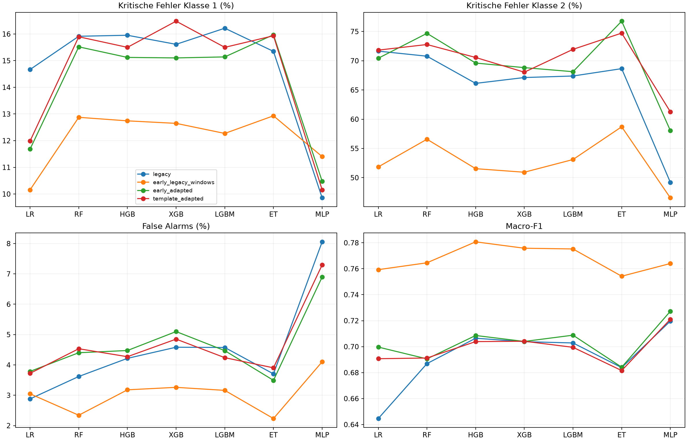

# Experimentelle Anker-/Fenstervarianten: Group-CV nur auf Trainingskörpern

Die Produktionspipeline, ursprünglichen Splits, Feature-Tabellen und Modelle bleiben
unverändert. Die neue Implementierung ist ausschließlich unter
`src/features/experimental_anchors.py`, `experimental_anchor_calculator.py` und
`src/experiments/anchor_group_cv.py` erreichbar. Sie wird nicht von bestehenden
Trainings-/Extraktionsskripten aufgerufen.

## Vorab festgelegtes Protokoll

**Nur die ursprünglichen 34.235 Trainingspunkte aus 23 Körpern** werden verwendet.
Originale Validation-/Test-CSV-Dateien, Rohsignale, Vorhersagen und Scores werden
nicht zur Entwicklung, Auswahl oder Evaluation dieser Varianten geladen.
Metallreferenzen sind über die feste Trainings-ID-Menge ausgeschlossen und werden
auch nicht zum Templatebau verwendet. Katalog-/Featuredateien werden gegebenenfalls
gestreamt; Nicht-Trainingszeilen werden vor jeder Statistik verworfen.
Prüfsummenlesen historischer Dateien dient nur dem Unverändertheitsnachweis.

Dreifache `StratifiedGroupKFold`, Seed 42, kanonisch sortierte IDs. Jeder Körper
liegt in genau einem CV-Validierungsfold. Es wird nicht nach Modellleistung an
Fold-Zuordnungen, Ankergrenzen oder Schwellen gedreht.

| CV-Validierungsfold | Punkte | Körper | Klasse 0 | Klasse 1 | Klasse 2 | Klasse 3 |
| --- | ---: | ---: | ---: | ---: | ---: | ---: |
| 0 | 11.975 | 8 | 1.562 | 2.032 | 744 | 7.637 |
| 1 | 11.841 | 8 | 1.594 | 1.854 | 878 | 7.515 |
| 2 | 10.419 | 7 | 1.397 | 1.411 | 681 | 6.930 |

Alle Folds enthalten alle vier Klassen und drei Messreihen. Körperdisjunktheit
ist anhand der vorhandenen räumlichen IDs geprüft; physische Wiederverwendung
zwischen Messreihen kann damit weiterhin nicht ausgeschlossen werden.

## Vier feste Varianten

| Variante | Anker | Post-Peak-Start / Ende | Baseline-/Rauschfenster relativ zum Anker |
| --- | --- | --- | --- |
| `legacy` | Bisheriges Maximum von abs(y−Median) in 980–1010 | 3 / 80 | 70–80 |
| `early_legacy_windows` | Erster ausreichend starker Impuls in 960–1030 | 3 / 80 | 70–80 |
| `early_adapted` | Derselbe frühe Impuls | adaptiv 6–9 / 80 | −10 bis −5 |
| `template_adapted` | Fold-Trainings-Template, normierte Korrelation | adaptiv 6–9 / 80 | −10 bis −5 |

Früher Impuls: erster lokaler Betrag-Peak mit Höhe ≥35 % und Prominenz ≥20 %
des Suchbereichmaximums. Dies ist eine eingefrorene Heuristik, keine physikalisch
verifizierte Oberfläche. »Früh« kann auch eine andere Pulslobe oder Störung treffen.

Template: maximal zwölf deterministisch über IDs verteilte Signale je **Fold-
Trainingskörper**, ohne Labelselektion. Diese werden am frühen Kandidaten ausgerichtet,
im Bereich −2,5 bis +4,5 abgetastet, einzeln normiert und im Vorzeichen vereinheitlicht.
Der Medianpuls wird mean-zentriert und normiert. Bei Anwendung wird absolute normierte
Korrelation im Suchbereich maximiert, mit Amplitudentor ≥35 % und Mindest-NCC 0,45.
Die Korrelation nutzt ein festes 0,05-Raster; die eigentlichen Featureformeln nutzen
die ursprünglichen Signalwerte und deren X-Achse. Polaritätsinvarianz der Suche
bedeutet nicht, dass die Polarität der extrahierten Rohsignale verändert wird.

Die angepasste Sperrzone setzt den Beginn hinter das Paket: geglätteter Betrag
(Glättung 0,15 Signal-X), 20-%-Pegel, begrenzte Paketsuche bis +8; Beginn
`clip(Paketende+1, 6, 9)`. Das soll vermeiden, nach einem früheren Anker erneut
Oberflächenringing als inneres Echo auszuwerten. −10 bis −5 als neues Rauschfenster
setzt eine ausreichend abgedeckte, signalärmere Prä-Impulsregion voraus. Es ist
nicht bewiesen, dass diese stets reinem Rauschen entspricht. Ende +80 und die
Formkorrelations-Halbbreite ±2,5 bleiben unverändert, um die Zahl der Faktoren zu begrenzen.
Alle X-Angaben sind aufgezeichnete Signal-Einheiten, keine hier neu kalibrierten ps/mm.

Die Anker-only-Ablation trennt den Markerwechsel vom kombinierten Fensterwechsel.
`early_adapted` versus `early_legacy_windows` ändert allerdings Start- und
Rauschfenster gemeinsam: deren Einzeleffekte werden nicht kausal getrennt.
Die zwei angepassten Varianten verwenden dieselbe Fensterregel, aber unterschiedliche Marker.

## Feature-Neuberechnung und Fold-Isolation

Die 17 ankerunabhängigen Features werden unverändert aus der bestehenden,
prüfsummengesicherten Rohfeature-Tabelle übernommen. Die 35 abhängigen Features
werden neu berechnet. Der separate Kalkulator ist eine explizite Kopie der bestehenden
Formeln mit Marker-/Fensterargumenten; keine Produktionsdatei wird verändert oder
zur Laufzeit umgeschrieben. Exakte Formelbeibehaltung wird synthetisch und an
64 festen **Trainingsmessungen** geprüft; die Tabelle erfüllt dort die dokumentierte
numerische Reproduzierbarkeitstoleranz.

Frühe Marker und paketbezogene Fenster hängen nur vom einzelnen Signal ab und
dürfen vor der CV gecacht werden. **Templatezustände werden je Fold ausschließlich
aus dessen Trainingskörpern gebildet**; zugehörige Sample-IDs und Templatearrays
werden gespeichert. Auch die Features für CV-Validierung werden nur mit diesem
Fold-Trainings-Template berechnet, nie mit einem globalen Template.

Fehlgeschlagene Extraktionen erhalten NaN in den 35 Erweiterungsspalten und einen
Diagnosegrund. Es gibt weder stilles Fallback zum alten Anker noch Row-Dropping.
Alle Varianten und Modelle haben daher identische CV-Populationen. Die unveränderten
17 Features bleiben verfügbar. Diese konservative Blockbehandlung kann Ergebnisse
mitbeeinflussen; fehlgeschlagene Fälle sind keine physikalisch korrigierten Signale.

Jeder Fit startet mit einer frischen Registry-Pipeline (sieben bisherige Modelle,
Seed 42, unveränderte Klassifikator-Hyperparameter). Neu vorgeschaltet ist
`SimpleImputer(strategy='median', keep_empty_features=True)`. **Imputer,
Varianzfilter und gegebenenfalls StandardScaler fitten ausschließlich innerhalb
des Fold-Trainings**. Kein bereits auf allen Trainingskörpern gefitteter Imputer
wird wiederverwendet. Template, Imputer und Modell sind als Artefakte verfügbar.
Die HGB-interne Zufallsvalidierung für Early Stopping bleibt als unveränderter
Modellstandard innerhalb der Fold-Trainingsdaten bestehen; sie ist selbst nicht
gruppenbewusst. Der äußere CV-Validierungsfold bleibt vollständig ausgeschlossen.

## Auswertung und Aussagegrenzen

84 Fits: vier Varianten × sieben Modelle × drei Folds. Vollständige OOF-Vorhersagen
für alle ursprünglichen Trainingspunkte, Fold- und Körpermetriken sowie 4×4-
Konfusionsmatrizen werden gespeichert. Kritische Fehler werden für wahre Klasse 1
und wahre Klasse 2 **getrennt** gezählt und jeweils durch deren Support geteilt.
False Alarms: wahre 3 → 1/2, Nenner wahre 3. Raten sind Prozentwerte. Macro-F1
bezieht sich im gepoolten OOF-Vergleich auf die vier Originalklassen.

Die Varianten und Parameter wurden vor dem ersten Fit eingefroren (`plan.json`).
Dies ist ein gepaarter, explorativer Vergleich fester Hypothesen, keine verschachtelte
Modellselektion und kein unverzerrter Leistungsnachweis einer nachträglich gewählten
Gewinnervariante. Drei Folds sind keine drei unabhängigen Replikationen.
Absolute Zahlen sind nicht direkt mit den früheren ursprünglichen Validation-/Test-
Scores vergleichbar: CV trainiert auf weniger und anderen Körpern.

Die Hypothesen sind durch die vorangegangenen, bereits bekannten Holdout-Diagnosen
motiviert. Diese Vorkenntnis lässt sich retrospektiv nicht aufheben. **Im aktuellen
Experiment werden jene Körper nicht erneut verwendet.** Bestätigung erfordert
weitere unabhängige Körper und eine fachliche Festlegung des physikalischen Ankers.
Es gibt keine automatische Übernahme eines CV-Siegers in die Produktionspipeline.

## Reproduktion und Artefakte

```sh
OPENBLAS_NUM_THREADS=1 OMP_NUM_THREADS=1 MKL_NUM_THREADS=1 \
  .venv/bin/python -m src.experiments.anchor_group_cv prepare \
  --output-dir /path/to/new-anchor-experiment --workers 4
OPENBLAS_NUM_THREADS=1 OMP_NUM_THREADS=1 MKL_NUM_THREADS=1 PYTHONHASHSEED=42 \
  .venv/bin/python -m src.experiments.anchor_group_cv train \
  --output-dir /path/to/new-anchor-experiment
```

Aktueller Lauf: `results/experiments/anchor_group_cv_v1/`. Vorhandene Ausgabeziele
werden abgelehnt. `cohort_folds.csv`, `plan.json`, `features/`, `templates/`,
Rohdaten-/Extraktionshashes und Quell-/Umgebungsstand dokumentieren die Vorbereitung.
Unter `cv/` liegen sämtliche Foldmodelle mit trainierter Vorverarbeitung,
OOF-Vorhersagen, Fold-/Körper-/Gesamtmetriken und ein **neuer lokaler MLflow-Store**.
Bestehende Tracking-Stores werden nicht beschrieben. Ein Run entspricht einem Fold-Fit.

## Ergebnisse des abgeschlossenen CV-Vergleichs

**Stärkster interner Kandidat ist `early_legacy_windows`, nicht das angepasste Fensterpaket.**
Gepoolter Macro-F1 steigt bei allen sieben Modellen; kritische Klasse-2-Fehler sinken
bei allen sieben. Klasse-1-Fehler sinken bei sechs Modellen, steigen beim MLP.
False Alarms sinken bei sechs Modellen, steigen geringfügig bei LR.
Das ist keine universelle Dominanz und keine physikalische Verifikation des Markers.

OOF-Support: **5.297 Klasse-1-, 2.303 Klasse-2- und 22.082 Klasse-3-Punkte**.
Jede Vorhersage stammt aus einem Fit ohne den betreffenden Körper. Tabellenraten sind Prozent.

### legacy

| Modell | Macro-F1 | Kritisch 1 n (%) | Kritisch 2 n (%) | False Alarms n (%) |
| --- | ---: | ---: | ---: | ---: |
| logistic_regression | 0.6446 | 777 (14.67) | 1650 (71.65) | 636 (2.88) |
| random_forest | 0.6869 | 843 (15.91) | 1630 (70.78) | 799 (3.62) |
| hgb | 0.7065 | 845 (15.95) | 1523 (66.13) | 931 (4.22) |
| xgboost | 0.7038 | 827 (15.61) | 1546 (67.13) | 1012 (4.58) |
| lightgbm | 0.7028 | 859 (16.22) | 1552 (67.39) | 1010 (4.57) |
| extra_trees | 0.6838 | 813 (15.35) | 1581 (68.65) | 818 (3.70) |
| mlp | 0.7197 | 522 (9.85) | 1133 (49.20) | 1779 (8.06) |

### early_legacy_windows

| Modell | Macro-F1 | Kritisch 1 n (%) | Kritisch 2 n (%) | False Alarms n (%) |
| --- | ---: | ---: | ---: | ---: |
| logistic_regression | 0.7593 | 538 (10.16) | 1194 (51.85) | 673 (3.05) |
| random_forest | 0.7646 | 682 (12.88) | 1303 (56.58) | 517 (2.34) |
| hgb | 0.7807 | 675 (12.74) | 1187 (51.54) | 702 (3.18) |
| xgboost | 0.7758 | 670 (12.65) | 1173 (50.93) | 720 (3.26) |
| lightgbm | 0.7752 | 650 (12.27) | 1223 (53.10) | 698 (3.16) |
| extra_trees | 0.7542 | 685 (12.93) | 1352 (58.71) | 493 (2.23) |
| mlp | 0.7640 | 604 (11.40) | 1072 (46.55) | 906 (4.10) |

### early_adapted

| Modell | Macro-F1 | Kritisch 1 n (%) | Kritisch 2 n (%) | False Alarms n (%) |
| --- | ---: | ---: | ---: | ---: |
| logistic_regression | 0.6997 | 619 (11.69) | 1622 (70.43) | 836 (3.79) |
| random_forest | 0.6906 | 822 (15.52) | 1720 (74.69) | 972 (4.40) |
| hgb | 0.7086 | 801 (15.12) | 1603 (69.60) | 988 (4.47) |
| xgboost | 0.7040 | 800 (15.10) | 1585 (68.82) | 1126 (5.10) |
| lightgbm | 0.7088 | 802 (15.14) | 1569 (68.13) | 987 (4.47) |
| extra_trees | 0.6842 | 846 (15.97) | 1768 (76.77) | 771 (3.49) |
| mlp | 0.7273 | 555 (10.48) | 1337 (58.05) | 1523 (6.90) |

### template_adapted

| Modell | Macro-F1 | Kritisch 1 n (%) | Kritisch 2 n (%) | False Alarms n (%) |
| --- | ---: | ---: | ---: | ---: |
| logistic_regression | 0.6907 | 635 (11.99) | 1654 (71.82) | 822 (3.72) |
| random_forest | 0.6912 | 842 (15.90) | 1676 (72.77) | 1001 (4.53) |
| hgb | 0.7039 | 821 (15.50) | 1625 (70.56) | 943 (4.27) |
| xgboost | 0.7042 | 873 (16.48) | 1567 (68.04) | 1071 (4.85) |
| lightgbm | 0.6995 | 821 (15.50) | 1657 (71.95) | 936 (4.24) |
| extra_trees | 0.6816 | 844 (15.93) | 1721 (74.73) | 862 (3.90) |
| mlp | 0.7211 | 538 (10.16) | 1411 (61.27) | 1611 (7.30) |



### Stabilität und Grenzen der Ergebnisse

Der Macro-F1-Vorteil von `early_legacy_windows` tritt in **allen 21 gepaarten
Modell/Fold-Vergleichen** auf. Klasse-2-Fehler sind in 20/21, False Alarms in
20/21, Klasse-1-Fehler aber nur in 14/21 niedriger. Beim MLP erhöht sich die
Klasse-2-Rate in einem Fold um 7,39 Prozentpunkte, obwohl sie gepoolt sinkt.
Die Körpertabellen und `body_direction_counts.csv` dokumentieren weitere Heterogenität.

Beispiel HGB: `legacy` → `early_legacy_windows` erhöht Macro-F1 von 0,7065 auf
0,7807. Klasse-1-Fehler sinken 15,95 → 12,74 %, Klasse-2-Fehler 66,13 → 51,54 %,
False Alarms 4,22 → 3,18 %. Das angepasste Paket erreicht dagegen Klasse-2-Raten
69,60 % (`early_adapted`) bzw. 70,56 % (`template_adapted`).

Die zusätzliche Sperrzone +6 bis +9 und das Prä-Impuls-Rauschfenster haben somit
keinen belastbaren gemeinsamen Vorteil gezeigt. Möglicherweise gehen informative
frühe Signalanteile verloren oder die Prä-Impulsregion ist keine geeignete Baseline.
Weil beides gemeinsam geändert wurde, ist keine einzelne Ursache identifiziert.
Umgekehrt kann die erfolgreiche +3-Variante noch Oberflächenloben als vermeintlichen
Nach-Peak nutzen. Bessere CV-Leistung beweist keinen physikalisch richtigen Hohlraumecho.

Auch der Templatevergleich ist konkret begrenzt: Er bewertet ein einzelnes Median-
template, Amplitudentor, NCC-Regel, Fensterpaket und die übernommenen Peakbedingungen.
Andere Templates oder packetbasierte Definitionen werden dadurch nicht ausgeschlossen.

### Extraktionsausfälle und Konvergenz

Die frühen bisherigen Fenster haben 0, die frühen angepassten Fenster 8 OOF-Ausfälle
(alle Klasse 0: kein negativer Nach-Peak). Das Templatepaket hat **471 OOF-Ausfälle**:
317 Klasse-0-Fälle ohne negativen, 150 Klasse-1-, ein Klasse-2- und zwei Klasse-3-Fälle
ohne positiven Nach-Peak sowie einen Klasse-1-Fall mit zu niedriger NCC.
Die 472–473 Ausfälle je komplettem Fold-Template-Cache sind davon zu unterscheiden:
für OOF zählt je Punkt nur das Template seines ausgeschlossenen Folds.

Ausfälle wurden nicht entfernt; alle 35 Erweiterungswerte werden dann imputiert.
Das kann den Templatevergleich benachteiligen und ist keine bloße Anker-Güteprüfung.
Es macht auch die übernommene Forderung nach beiden Peakvorzeichen als Abhängigkeit sichtbar.
Die vollständigen 17 ankerfreien Features bleiben erhalten.

Alle zwölf MLP-Fits (vier Varianten × drei Folds) erreichen das unveränderte
200-Iterationen-Limit ohne vollständige Konvergenz. Es wurde nicht nachtrainiert
und das Limit nicht angepasst. Die Warnungen liegen bei den Modellen.

### Schlussfolgerung und nächste, noch nicht ausgeführte Schritte

1. Frühen Marker mit bisherigen Fenstern als **experimentellen Kandidaten** weiter
   fachlich prüfen; nicht automatisch in die Produktion übernehmen.
2. Sperrzone/Paketende und Rauschfenster erst in getrennten, vorab festgelegten
   Trainingskörper-Ablationen untersuchen. Die jetzigen Ergebnisse rechtfertigen
   weder eine pauschale Fensterverlagerung noch eine automatische Template-Übernahme.
3. Extraktionsausfälle und Vorzeichenbedingungen fachlich prüfen, bevor ein anderes
   Template als grundsätzlich besser oder schlechter bewertet wird.
4. Klasse 2 bleibt selbst beim stärksten Kandidaten mit 46,55–58,71 % kritischen
   Fehlern problematisch. Weitere unabhängige Körper und Annotation-/Geometrie-
   Klärung sind wichtiger als eine bloße Behauptung korrekter Ankerphysik.

Keine bestehenden Holdout-Scores wurden für diese Schlussfolgerung verwendet.
Die vergleichenden OOF-Zahlen sind explorativ und konditional auf diesen CV-Folds.

## Abschlussprüfung

**167 Tests bestanden.** Alle 84 gespeicherten Foldmodelle wurden erneut geladen:
ihre CV-Vorhersagen sind exakt identisch. Die Imputationsmediane aller Fits und
die Scaler-Mittelwerte wurden gegen die jeweiligen Fold-Trainingsdaten geprüft.
Template-Sample-IDs liegen ausschließlich im Fold-Training. Die Foldzuordnung
ist auch nach Umsortierung der echten Eingangstabelle identisch.

Die vorgegebenen Modellparameter stimmen in allen Fits mit der bisherigen Registry
überein; XGBoost setzt sein Multiklassen-Objective wie im Standard automatisch beim
Fit auf `multi:softprob`. Das ist keine neue Hyperparameterwahl.
59.236 geschützte bestehende Dateien und alle 34.235 Rohsignale sind unverändert.
Die Rohsignale stimmen zusätzlich mit dem zuvor auditierten Datenstand überein.
Ein vollständiges zweites Training wurde nicht durchgeführt; die Prüfung belegt
Reproduzierbarkeit der gespeicherten Modell-/Vorverarbeitungsartefakte in dieser Umgebung.

`verification.json`, `paired_oof_deltas.csv`, Fold-Deltas, Extraktionsdiagnosen und
Körper-Differenzzählungen ergänzen die eigentlichen CV-Ergebnisse. Die zwölf
MLP-Konvergenzwarnungen wurden aufgezeichnet; Warnungen bei reinen Körpermetriken
entstehen zudem durch dort fehlende Klassen. Gepoolte und Foldmetriken enthalten alle vier Klassen.

**Nicht untersucht:** Template Matching mit den alten Fenstern als eigener Faktor,
weitere Start-/Rauschfenster oder numerisches Tuning der Marker. Der Template-
Befund darf deshalb nicht als generelle Ablehnung von Template Matching gelesen werden.

Wichtiger MLP-Zielkonflikt: Die Anker-only-Variante senkt dort Klasse-2-Fehler
um 61, erhöht Klasse-1-Fehler jedoch um 82. Insgesamt entstehen daher **1.676 statt
1.655 kritische OOF-Fehler** (22,05 statt 21,78 % bei Support 7.600). Der höhere
Macro-F1 und die weniger häufigen False Alarms bedeuten für das MLP keine Verbesserung
aller kritischen Fehler. Eine einheitliche Umstellung aller Modelle ist daraus
nicht abzuleiten.
