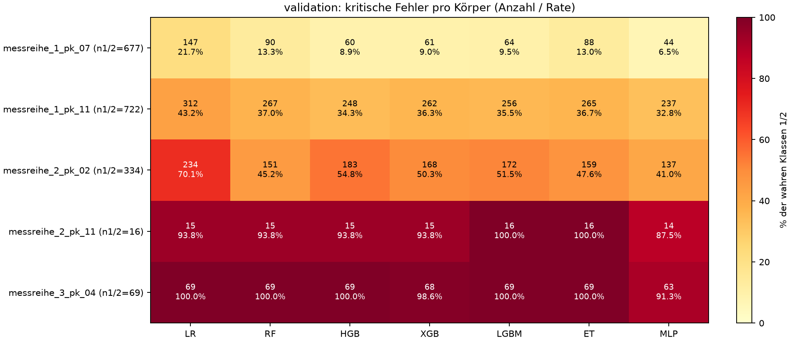
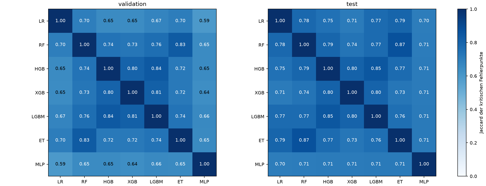
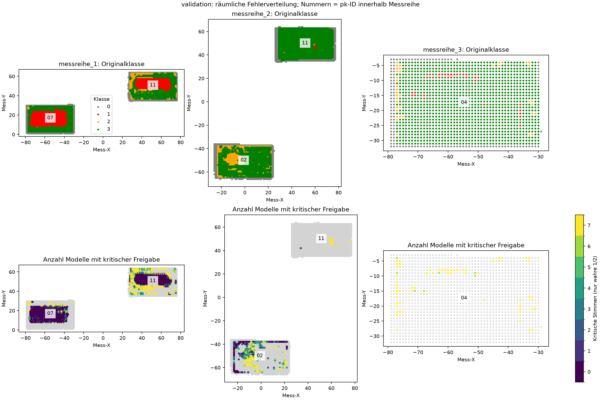
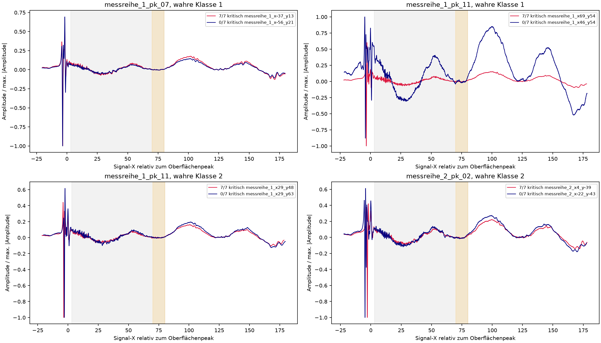
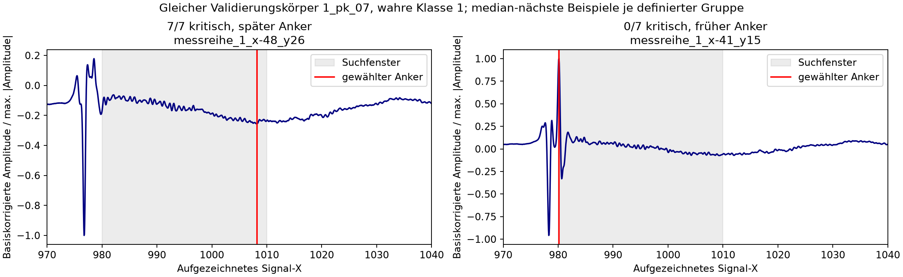
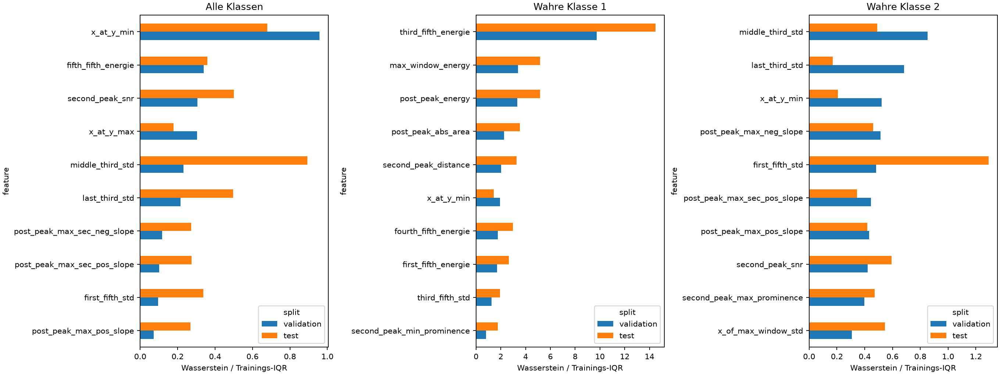

# HeRAI-Fehleranalyse: sieben Modelle, 52 manuelle Features

**Befund:** Kritische Fehler sind stark körper- und klassenabhängig. Klasse 2 und
räumliche Übergänge dominieren. Viele Fehler teilen alle Modelle; bloßes Mehrheitsvoting
beseitigt diese Fälle nicht. Es gibt Verteilungsunterschiede und konkrete Prüfpunkte
bei Signalausrichtung/Normalisierung, aber keinen kausalen Nachweis eines fehlenden Features.

## Umfang und Zählweise

Untersucht wurden ausschließlich die gespeicherten Vorhersagen des letzten
`specimen_manual52_v1`-Laufs: LR, Random Forest, HGB, XGBoost, LightGBM,
Extra Trees und MLP. Validation und explorativer Test bleiben getrennt.
Die Diagnose führt keine neuen HeRAI-Trainings, Inferenz-, Optimierungs- oder Auswahl-Läufe aus.
Die Kompatibilitätstests verwenden wie bisher synthetische Modelle in temporären Verzeichnissen.
Die 52 vorhandenen Features und 4.092 vorhandene Rohsignale mit Originalklasse 1/2
wurden rein deskriptiv untersucht. Referenzflächen bleiben ausgeschlossen.

Kritisch bedeutet ausschließlich Originalklasse 1/2 → Vorhersage 3.
Ein **Modellfehler-Ereignis** ist ein Punkt-Modell-Paar; derselbe Punkt kann bis zu
sieben Ereignisse verursachen. Die mittlere Modellrate ist Ereignisse/(7 × Support).
Sie ist keine Ensemble-Leistung. »0/7 kritisch« kann andere Klassifikationsfehler
enthalten und bedeutet nicht automatisch »korrekt«. Klassen 0/3 sind keine
Nennerklassen dieser Analyse; ihre kritische Rate wird nicht als Sicherheitsnachweis angegeben.

## 1. Gesichert: Fehlerquellen und gemeinsame Fehler

| Holdout | Wahre 1/2-Punkte | Mindestens ein Modell kritisch | Alle sieben kritisch | Ereignisse |
| --- | ---: | ---: | ---: | ---: |
| Validation | 1.818 | 869 | 357 | 4.187 |
| Test, explorativ | 2.274 | 947 | 473 | 5.020 |

Klasse 2 verursacht in Validation 3.137/4.187 = **74,9 %** der Ereignisse,
obwohl sie nur 657/1.818 = 36,1 % der kritischen Zielpunkte ausmacht.
Die mittlere Modellrate beträgt **68,21 % für Klasse 2**, **12,92 % für Klasse 1**.
280 der 357 gemeinsamen Fehler betreffen Klasse 2. Im explorativen Test:
Klasse 2 62,96 %, Klasse 1 15,89 %; 297 der 473 gemeinsamen Fehler sind Klasse 2.

### Prüfkörper: Validation

| Prüfkörper | Support 1/2 | Ereignisse | Mittlere Modellrate | Alle sieben kritisch |
| --- | ---: | ---: | ---: | ---: |
| messreihe_1_pk_07 | 677 | 554 | 11,69 % | 32 |
| messreihe_1_pk_11 | 722 | 1.847 | 36,55 % | 171 |
| messreihe_2_pk_02 | 334 | 1.204 | 51,50 % | 78 |
| messreihe_2_pk_11 | 16 | 106 | 94,64 % | 14 |
| messreihe_3_pk_04 | 69 | 476 | 98,55 % | 62 |

**1_pk_11 und 2_pk_02 verursachen zusammen 72,9 % der Ereignisse** bei 58,1 %
des Supports. Die beiden fast vollständig verfehlten kleinen Fälle 2_pk_11 und
3_pk_04 sind wegen n=16 bzw. n=69 separat zu betrachten.

Messreihen in Validation: Reihe 1 **24,52 %** bei n=1.399, Reihe 2 **53,47 %**
bei n=350, Reihe 3 **98,55 %** bei n=69. Die Reihenraten sind zugleich von der
Körper-/Klassenmischung abhängig und kein isolierter Instrumenteneffekt.

Im explorativen Test dominieren 1_pk_10 (1.774 Ereignisse; 85,62 % bei n=296)
und 2_pk_14 (1.420; 93,48 % bei n=217): zusammen 63,6 % der Ereignisse.
Reihe 3 umfasst dort nur fünf Klasse-2-Punkte, alle sieben Modelle verfehlen alle
fünf; Klasse 1 fehlt. Daraus folgt keine belastbare allgemeine Rate für Reihe 3.



### Modellgemeinsamkeiten und räumliche Lage

Jaccard der kritischen Fehlerpunktmengen in Validation: **0,592–0,843**.
HGB und LightGBM teilen 527 Fehler (Jaccard 0,843), mit 48 bzw. 50 jeweils
exklusiven Fehlern. LR und MLP teilen 473; LR hat zusätzlich 304, MLP zusätzlich
22 kritische Fehler. Das ist keine pauschale MLP-Dominanz: MLP verursacht auf
Validation 317 False Alarms gegenüber 59 bei LR. Das MLP erreichte außerdem
sein unverändertes 200-Iterationen-Limit ohne vollständige Konvergenz.
Der explorative Test hat Jaccard 0,700–0,872; dort teilen RF/Extra Trees besonders viele Fehler.



Die räumlichen Karten zeigen vor allem Übergangszonen und kleine annotierte Inseln.
Zusätzlich gemessene Entfernung zum nächsten Klasse-3-Punkt innerhalb desselben Körpers:
In beiden vergleichbaren Klasse-1-Strata der Validation liegt der Median bei
**1 Koordinateneinheit** für gemeinsame Fehler, bei **4** für Punkte ohne kritische
Freigabe. Bei 1_pk_11/Klasse 2: **1 versus 3**; bei 2_pk_02/Klasse 2: **1 versus 1**.
Randeffekte sind damit nicht universell. Koordinaten werden nur zur Diagnose verwendet,
nicht als ML-Features. Nähe zur Annotation ist kein Beleg falscher Annotation.



## 2. Gesichert: Signalcharakteristika, mit kontrollierter Gegenüberstellung

Featurekontraste vergleichen nur **denselben Körper und dieselbe wahre Klasse**:
7/7 kritisch gegen 0/7 kritisch, jeweils mindestens fünf Punkte. In Validation
sind dafür nur vier Strata verfügbar, darunter bei 1_pk_11/Klasse 2 nur acht
Kontrollpunkte. Die Tabellen zeigen Strata einzeln; keine punktweisen p-Werte.

- Klasse 2: In beiden vergleichbaren Körpern liegen `y_mean` etwa 0,90 Trainings-
  Klassen-IQR höher, `y_std` etwa 0,70–1,29 IQR höher, absolute Vollsignalenergien
  hingegen niedriger. Offset-/Formunterschiede sind beobachtet; ihre Ursache ist offen.
- »Schwache Signale verursachen alle Fehler« wird **nicht** gestützt: Bei Klasse 2
  ist `second_peak_snr` bei gemeinsamen Fehlern in beiden Strata geringfügig höher,
  nicht niedriger. Auch Oberflächenamplituden unterscheiden sich nicht einheitlich.
- Klasse 1 ist heterogen: Auf 1_pk_07 haben gemeinsame Fehler eine deutlich höhere
  `third_fifth_energie` (Median 26,03 gegenüber 1,20), auf 1_pk_11 dagegen 1,12
  gegenüber 1,17. Ein einziger globaler Energie- oder SNR-Grenzwert erklärt dies nicht.

Die median-nächsten Wellenformpaare sind illustrative Beispiele, keine Leistungs-
oder Kausalitätsprüfung. Sie sind je Körper/Klasse deterministisch über vier
bestehende Signalfeatures gewählt; IDs und Auswahlverfahren sind gespeichert.



### Signalfenster und Oberflächenanker: Befund versus Hypothese

Der bestehende Extraktor sucht den Oberflächenanker bei Signal-X **980–1010**,
nutzt post-peak **3–80** relativ zum Anker und schätzt Rauschen in **70–80**.
Diese Regeln wurden unverändert gelesen und angewendet.

**Befund:** In Validation liegt das stärkste basiskorrigierte Extremum vor 980
bei 80,10 % der Klasse-1- und 97,56 % der Klasse-2-Signale. Unter gemeinsamen
Fehlern sind es 99,44 %, unter 0/7-kritisch-Fällen 75,66 %; dieser gepoolte Vergleich
ist durch Körper/Klasse konfundiert. Das stärkste Extremum muss nicht der physische
Oberflächenreflex sein — eine falsche Ankerdefinition ist dadurch nicht bewiesen.

Auf 1_pk_07/Klasse 1 liegen die Anker-Mediane bei gemeinsamen Fehlern bei 1007,60,
bei 0/7 kritisch bei 980,50. Aber: **202 der 500 Kontrollpunkte haben ebenfalls
einen Anker >1000**. In dieser Klasse haben 11/281 Punkte mit spätem und 8/381 mit
früherem Anker sieben gemeinsame Fehler. Ankermehrdeutigkeit ist somit ein konkreter
Prüfpunkt, keine hinreichende Erklärung der Fehler. Das folgende Beispiel kontrastiert
gezielt diese beiden Ankerregime; es ist keine repräsentative Kausalitätsstichprobe.



Alle 4.092 geprüften Signale reichen nach Ausrichtung mindestens bis relativ X=150.
Im Median liegen **83,9 %** ihrer basiskorrigierten Quadratsumme nach X=80
(bezogen auf den Bereich ab X=3). Dieser Anteil ist von Fensterlänge und breiten
Hintergrundschwingungen beeinflusst und bei Fehlern/Kontrollen ähnlich.
**Kein Nachweis**, dass dort diskriminative Hohlrauminformation fehlt. Die 17
Vollsignalfeatures erfassen den späten Bereich ohnehin summarisch; die 35
spezialisierten Features lokalisieren ihn bisher nicht.

## 3. Hinweise auf Distribution Shift, keine gesicherte Ursachenidentifikation

Klassenprioren Training / Validation / Test (%): Klasse 2 **6,73 / 8,74 / 7,22**,
Klasse 3 **64,50 / 60,67 / 64,58**. Zusätzlich unterscheiden sich innerhalb der
Klassen die Featureverteilungen. Verwendet wurde Wasserstein-Abstand geteilt
durch den jeweiligen Trainings-IQR, ohne Annahme unabhängiger Messpunkte.



Beispiele: Klasse-1-`second_peak_distance` hat Median 24,30 im Training, 25,30 in
Validation und 20,43 im explorativen Test. Klasse-2-SNR: 23,34 / 18,19 / 20,49.
Klasse-1-Energien zeigen stark verschiedene Anteile einer hohen Energiemode:
`third_fifth_energie` hat Wasserstein/IQR 9,75 in Validation und 14,47 im Test,
obwohl viele Mediane ähnlich bleiben. **Kleine Trainings-IQR und seltene hohe
Werte können diese Normierung stark vergrößern**; das ist kein Beweis einer
entsprechend großen Verschiebung aller Punkte oder fehlenden Trainingsabdeckung.

Auch innerhalb derselben Messreihe und Klasse bleiben Unterschiede:
Reihe 2/Klasse 2 hat SNR-Median 21,95 im Training (n=1.031) und 12,95 in Validation
(n=339). Reihe 3/Klasse 2 hat nur 24 Trainingspunkte; Delay-Mediane 48,45 im
Training versus 26,10 in Validation (n=38). Der schwache Support begrenzt Aussagen.
Die sehr großen marginalen Energieabstände werden durch Körper-, Quellen- und
Modenmischung mitgeprägt. **Geänderte Stichprobenverteilungen sind belegt;
Instrumentendrift oder ein kausaler Shift-Fehler-Zusammenhang nicht.**

## 4. Priorisierte nächste Experimente — hier nicht ausgeführt

| Priorität | Experiment / Vorprüfung | Begründung und Erfolgskriterium |
| --- | --- | --- |
| P0 | Annotation/Signaldefinition blind prüfen: kleine Klasse-1/2-Inseln, Klasse-2-Ränder und physische Oberflächenlage; vorhandene Referenzen nur zur Signaldiagnose | Gemeinsame Fehler und Ankermehrdeutigkeit. Original-Labels/Artefakte behalten; keine Behauptung, Klasse 2 sei physisch falsch annotiert. |
| P1 | Separater Block für ankerrobuste Morphologie: physikalisch begründete Suchregion, mehrere bipolare Kandidaten, Ankerkonfidenz, relative Echoabstände | Testen, ob Features bei Ankerwechseln stabiler werden. Keine blinde Wahl des größten Impulses und keine globale Verlagerung des bestehenden Fensters ohne Freigabe. |
| P1 | Zusätzliche offset-/skalierungsrobuste Statistiken, baselinekorrigierte Vollsignalwerte, lokale Prominenzen und Energieverhältnisse; Rausch-/Ankerqualitätsmerkmale | Bestehende globale Features reagieren auf Offset/Form; bestehendes SNR erklärt Fehler nicht allgemein. Originale 52 Features für Ablationen erhalten. |
| P2 | Mehrskalen-/Mehr-Echo-Morphologie: lokale Hüllkurve, Echoanzahl, Verzögerungen, Breiten und Ringing; gezielte späte Fenster erst nach Hintergrundprüfung | Rand-/Mischsignale und kleine Klasse-2-Unterschiede könnten durch Extremwerte und grobe Fünftel unterrepräsentiert sein. Späte Energie allein ist keine Hohlraum-Evidenz. |
| P2 | Trainingsabdeckung pro Körper/Klasse verbessern, insbesondere Reihe 3; datenarme/unsichere Annotationen fachlich prüfen | 24 Trainingspunkte für Reihe 3/Klasse 2 reichen nicht für belastbare Subgruppen-Generalisation. Mehr Features ersetzen keine zusätzlichen unabhängigen Körper. |

Das sind **Hypothesen für getrennte Experimente**, keine nachgewiesenen Verbesserungen.
Klassendominanz, Modell-/Entscheidungsregeln und Unsicherheit der Originalklasse 2
sind alternative Erklärungen neben Features. Insbesondere ist anhand gespeicherter
Vorhersagen weder das Fehlen diskriminativer Information noch ein Labelproblem bewiesen.
Ein einfacher Mehrheitsentscheid kann die 357 gemeinsamen Validierungsfehler nicht korrigieren.

Zukünftige Entwicklung nur innerhalb der Trainingskörper mit gruppierter innerer
Validierung, festgelegten Ablationen und identischen Modellparametern. Kritische
Fehler und False Alarms gemeinsam sowie Support/Rate pro Körper berichten;
Koordinaten, Körper- und Messreihen-IDs bleiben Metadaten. Beide jetzigen Holdouts
sind nach dieser Diagnose bekannt: ein dortiger Vergleich wäre explorativ.
Eine abschließende Leistungsbehauptung benötigt weitere unabhängige Körper und
Klärung möglicher physischer Wiederverwendung zwischen Messreihen.

## Artefakte und Reproduktion

Alle neuen Ausgaben: `results/analysis/herai_error_analysis_20261110/`.
Enthalten sind ID-bezogene Modellstimmen, Körper-/Quellen-/Klassentabellen,
Jaccard-Matrizen, klassen- und quellenbedingte Shift-Tabellen, kontrollierte
Featurekontraste, Rohsignaldiagnostik, räumliche Randabstände sowie beschriftete PNGs.
Der Test ist in allen Tabellen/Plots separat ausgewiesen und bleibt explorativ.
Trainingsfehler wurden nicht untersucht, da dafür keine gespeicherten Vorhersagen
vorliegen; es wurden auch keine neuen Trainingsvorhersagen berechnet.

```sh
MPLCONFIGDIR=/tmp/thz-specimen-mpl OPENBLAS_NUM_THREADS=1 OMP_NUM_THREADS=1 \
  .venv/bin/python -m src.analysis.specimen_error_analysis \
  --run-dir results/experiments/specimen_manual52_v1/baseline \
  --split-dir configs/specimen_holdout_v1/splits \
  --catalog data/measurements/combined_dataset.csv \
  --feature-dir results/experiments/specimen_manual52_v1/features \
  --output-dir /path/to/new-error-analysis
```

Ergänzende Diagnoseskripte und der ausgeführte Hauptquellstand sind im neuen
Analyseordner archiviert; dessen Manifeste halten Eingangs-/Ausgabehashes fest.
Die zusätzlichen Rohsignalgrößen sind ausschließlich Diagnoseartefakte,
keine geänderte oder neue ML-Feature-Tabelle. Bestehende Modelle, Ergebnisse,
Tracking-Stores, Originaldaten und Split-Manifeste blieben unverändert.
Tests: **159 bestanden**, sieben bekannte Bibliotheks-/synthetische Warnungen.
