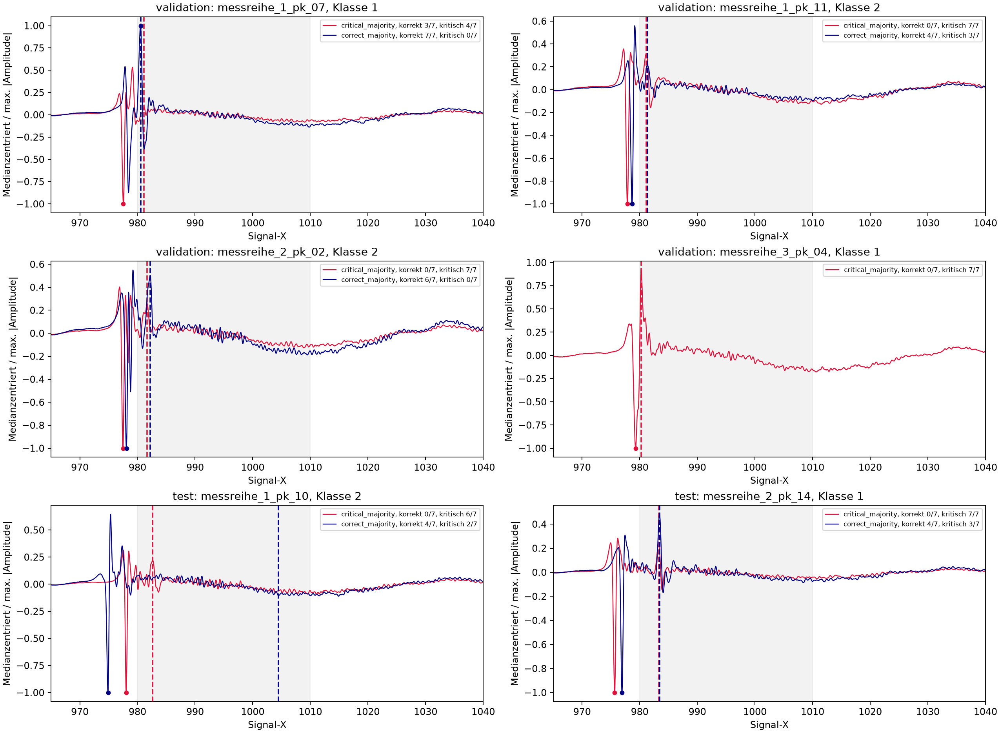
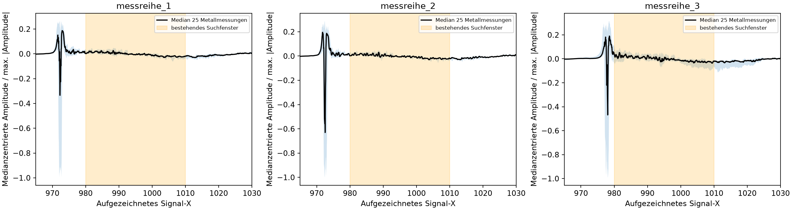
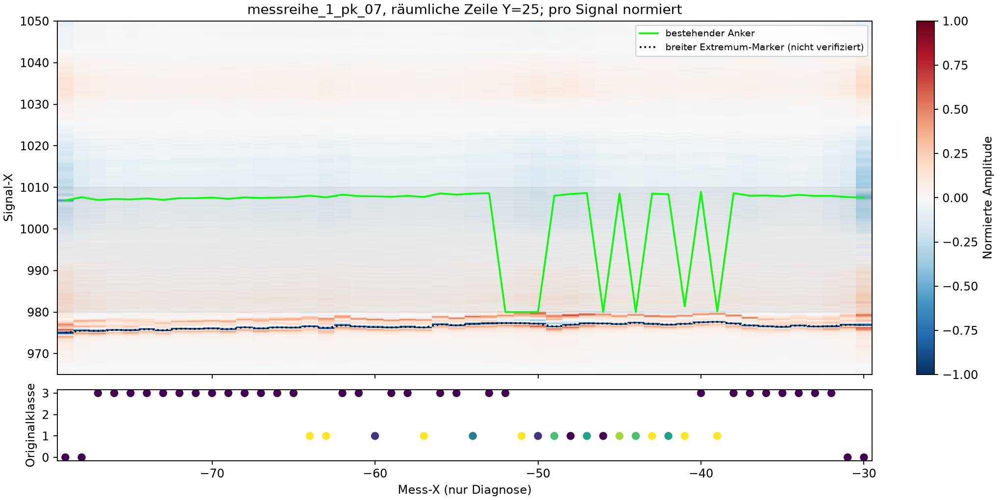
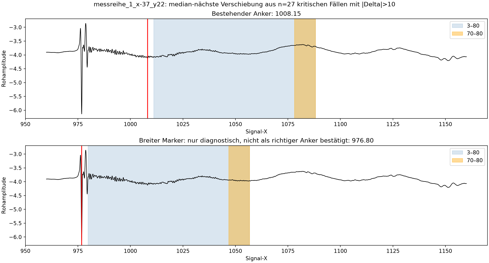
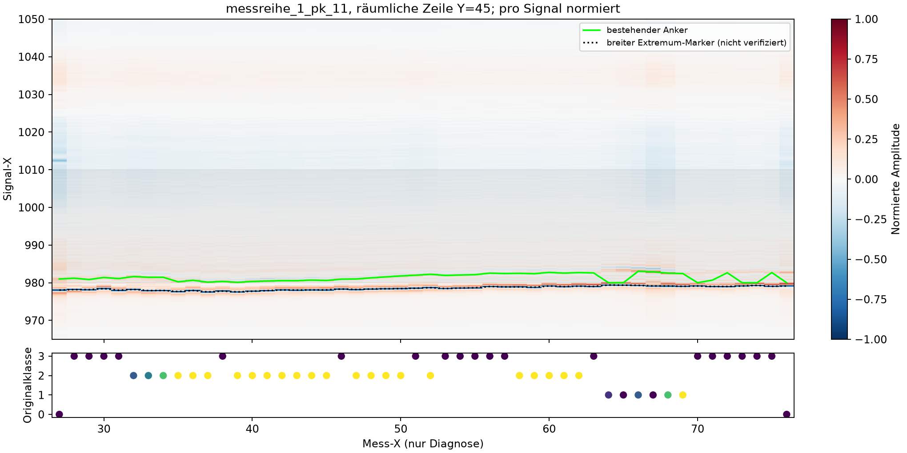

# Signalaufbereitung und Oberflächenanker — diagnostischer Review

**Ergebnis:** Das feste Fenster 980–1010 erfasst den dominanten frühen Impuls nicht
zuverlässig. Es kann zwischen einer Pulslobe und einem deutlich späteren, breiten
Signalanteil wechseln. Eine allgemeingültige physikalisch richtige Ankerposition
ist mit den vorhandenen Daten jedoch nicht verifiziert. Das Fenster jetzt pauschal
zu verschieben oder immer das größte Extremum zu verwenden, wäre nicht gerechtfertigt.

## Umfang und Auswahl

Neu untersucht: alle **4.092** vorhandenen Validation-/Testsignale der Klassen 1/2,
zusätzlich **75 Metallreferenzmessungen** (25 je Reihe, deterministisch über sortierte
IDs verteilt). Metallreferenzen dienen ausschließlich der Diagnose und bleiben
von Training und Evaluation ausgeschlossen. Validation und explorativer Test sind getrennt.

»Korrekt« bedeutet hier wirklich Vorhersage = Originalklasse: mindestens vier von
sieben Modellen. »Kritisch« bedeutet mindestens vier Freigaben nach 3 bei wahrer 1/2.
Die repräsentativen Paare stammen aus demselben Körper und derselben Klasse;
ausgewählt wurde jeweils die median-nächste bestehende Ankerposition, Gleichstände
nach ID. IDs, Gruppengrößen und sämtliche Modellstimmen sind gespeichert.
Wo kein korrekter Vergleichsfall existiert, wurde keiner aus einem anderen Körper ergänzt.
Das betrifft insbesondere 3_pk_04/Klasse 1. Die Beispiele repräsentieren Ankerlagen,
nicht sämtliche Morphologievarianten oder eine unabhängige Stichprobe.



## 1. Gesicherte Befunde zum Anker

Der bisherige Extraktor maximiert `abs(y - median(y))` innerhalb 980–1010.
Als **rein diagnostische Markierungen**, nicht als neuer Extraktor, wurden das
stärkste medianzentrierte Extremum und die stärkste Flanke im Bereich 960–1030 betrachtet.
Es wurden keine neuen ML-Features berechnet oder bestehende Featurewerte ersetzt.

| Metallreferenz, n=25 je Reihe | Bestehender Anker, Median | Breiter Extremum-Marker, Median | Median der paarweisen Differenz |
| --- | ---: | ---: | ---: |
| Messreihe 1 | 988,70 | 972,40 | 16,25 |
| Messreihe 2 | 988,80 | 972,55 | 16,25 |
| Messreihe 3 | 981,45 | 978,00 | 3,55 |

Die stärkste Flanke liegt im Median bei 972,6 / 972,7 / 978,1 und damit nahe am
frühen Impuls. Die Referenzplots zeigen, dass das bestehende Fenster in Reihe 1/2
vor allem spätere, schwächere Anteile enthält. Die Referenzlage ist wegen anderer
Geometrie/Abstände **nicht unmittelbar als feste Zeit für alle Prüfkörper übertragbar**.



In den gehaltenen 1/2-Signalen unterscheiden sich bestehender und breiter Marker
um mehr als 10 aufgezeichnete Signal-X-Einheiten bei **310/1.818 (17,05 %) in
Validation**, **161/2.274 (7,08 %) im explorativen Test**. Der bestehende Marker
liegt bei 14,80 % / 4,53 % nahe einer Suchfenstergrenze (Abstand ≤0,1).
Das sind Mehrdeutigkeits-/Beschneidungsindikatoren, keine bewiesenen Fehlankerquoten.

Auf einer räumlichen Zeile von 1_pk_07 springt der bestehende Marker zwischen
ungefähr 980 und 1008, während der frühe Impuls weitgehend kontinuierlich bleibt.
Das ist ein konkreter Hinweis auf einen Wechsel des gewählten Signalanteils.
Auch korrekt klassifizierte Signale können im späten Ankerregime liegen: Der
Anker allein erklärt daher nicht die Klassifikationsfehler.



Oben: pro Signal medianzentrierte/maximal normierte Rohamplitude, grün bestehender
Anker, schwarz diagnostisches Extremum. Unten: Originalklasse; Punktfarbe bezeichnet
kritische Modellstimmen von 0 (dunkelviolett) bis 7 (gelb). Mess-X ist nur Diagnosemetadatum.

**Physikalische Einordnung — Hypothese:** Der frühe bipolare Impuls ist ein
plausibler Oberflächenkandidat; Referenzen und räumliche Kontinuität stützen dies.
Ohne definierte Pulslobe/Packet-Referenz, Laufzeitnullpunkt und dokumentierte
Geometrie lässt sich weder jeder frühe Peak als Oberfläche noch jeder späte
Marker als falsch beweisen. Auch das stärkste Extremum kann bei Materialwechsel,
Überlagerung oder mehreren Reflexen seine Lobe wechseln.

## 2. Wie Mehrdeutigkeit die bestehende Extraktion beeinflusst

Ein konkreter Fall, `messreihe_1_x-37_y22`, hat bestehenden Anker 1008,15 und
breiten Marker 976,80: **31,35 Einheiten Differenz**. Das Post-Peak-Fenster liegt
entsprechend bei **1011,15–1088,15** versus **979,80–1056,80**; nur **59,29 %**
der Fensterlänge überlappen. Das Rauschfenster verschiebt sich ebenfalls vollständig.
Dieser Fall ist median-nächster Vertreter der 27 kritischen Fälle dieser
Körper-/Klassen-Gruppe mit |Differenz| >10, kein zufälliger Einzelfall.



Bei allen 310 großen Verschiebungen der Validation beträgt die mediane
Fensterüberlappung 59,35 %. Die Standardabweichung im alternativ verschobenen
Rauschfenster beträgt im Median das **0,515-Fache** des bisherigen Werts;
der Baseline-Mittelwert ändert sich im Median um **13,0 bisherige Rausch-Standardabweichungen**.
Das ist eine konkrete Sensitivität, kein Nachweis, dass das alternative Fenster
wirklich rauschfrei oder physikalisch besser ist.

Betroffen sind logisch insbesondere die **35 Erweiterungsfeatures**:

- Andere Samples in 3–80 verändern Peakauswahl, Energien, Ableitungen und Fünftelpositionen.
- Eine andere Baseline verändert Vorzeichen, positive/negative Kandidaten und Amplitudenverhältnisse.
- Ein anderer Rauschmaßstab verändert die SNR-Bedeutung; die SNR-Änderung lässt sich wegen
  zugleich geänderter Peak-/Baselinewerte nicht allein als Kehrwert des Rauschfaktors berechnen.
- Das Oberflächenfenster ±2,5 für die Formkorrelation kann einen anderen Signalanteil erfassen.

Die **17 ursprünglichen Vollsignalfeatures** benutzen den Oberflächenanker nicht
und sind von dessen alleiniger Verschiebung unmittelbar unabhängig. Eine zukünftige
globale Normalisierung würde dagegen auch sie beeinflussen.

Wichtig: Einfach auf den früheren Extremum-Marker umzuschalten und **3–80 unverändert
beizubehalten** ist keine vollständige Lösung. Dann kann eine weitere Lobe desselben
Oberflächenpakets schon im vermeintlichen Zweitpeak-Fenster liegen. Ankerdefinition,
Pulsende, Suchbereich für innere Echos und Rauschfenster müssen zusammen geprüft werden.

## 3. Annotationen und Übergänge

**Technisch gesichert:** Die Koordinatenzuordnung zu den drei Originalannotationstabellen
stimmt für alle **53.192** Messungen überein; **0 Labelabweichungen**, keine mehrdeutigen
Originalkoordinaten im Abgleich. Ein Übertragungsfehler erklärt die auffälligen Fälle nicht.
Das bestätigt die Übernahme, nicht die physikalische Wahrheit der Annotationen.

Auf der Zeile Y=45 von 1_pk_11 verläuft der frühe Impuls durch Bereiche mit Labels
3, 2 und 1 relativ kontinuierlich. Die Label-2-Bereiche enthalten viele gemeinsame
kritische Vorhersagen; es gibt aber auch tatsächlich korrekt als 2 vorhergesagte
Signale desselben Körpers. Auf 2_pk_02 fehlen in den vorhandenen Daten bestätigte
Klasse-1-Punkte; Klasse 2 darf dort nicht automatisch als sicherer Hohlraum behandelt werden.



**Plausible, ungeprüfte Erklärungen:** schwache/überlagerte Echos, Mischsignale an
räumlichen Übergängen oder eine bewusst konservative Unsicherheitsannotation.
Ein glatter Signalverlauf ist kein Beleg einer falschen Klasse-2-Grenze; Unterschiede
können schwach, phasenabhängig oder außerhalb des gezeigten Ausschnitts liegen.
Ohne Konstruktionsplan, unabhängige Defektprüfung und dokumentierte Label-2-Regel
ist keine fachliche Umklassifizierung begründbar. Es wurden keine Labels verändert
und keine automatischen »Labelkorrekturen« vorgeschlagen.

## 4. Priorisierte Empfehlungen — noch nicht implementiert

| Priorität | Nächste Prüfung / mögliche Verbesserung | Grenze / Freigabekriterium |
| --- | --- | --- |
| P0 | Physische Ankerdefinition festlegen: Pulslobe, Paketbeginn oder Referenz-Lag; Geometrie und Metallreferenzen fachlich abgleichen. Auffällige Rohsignale blind beurteilen. | Ein breiteres Fenster allein ersetzt diese Definition nicht. Referenzen bleiben außerhalb der ML-Datensätze. |
| P1 | Danach paket-/templatebasierte Ankerung mit zulässigem Laufzeitbereich und Mehrdeutigkeitskennung untersuchen; nicht nur maximalen Ausschlag wählen. | Kandidat muss Referenz-/Nachbarschaftskonsistenz und Wiederholstabilität zeigen. Räumliche Nachbarn dienen hier nur der Prüfung, nicht als Modellfeature oder Testdaten-Hilfe. |
| P1 | Rausch-/Baselinefenster getrennt von der Ankerwahl validieren; signalärmere Abschnitte, robuste Lage-/Streuungsmaße und Drift prüfen. | Weniger Varianz bedeutet nicht automatisch besseres Rauschen: echte Echos dürfen nicht als Rauschen unterdrückt werden. |
| P2 | Normalisierung vergleichen: Offsetkorrektur und packetbasierte Skalierung; absolute Amplitude/Qualitätsinformation separat bewahren. | Die hier normierten Bilder sind nur Visualisierung. Ein Klassifikationsgewinn ist nicht gemessen; nützliche Amplitudeninformation darf nicht blind entfernt werden. |
| P2 | Fenster nach Ende des Oberflächenpakets beginnen lassen; Echo-/Materiallaufzeiten und breitere/spätere Abschnitte physikalisch prüfen. | Ein früherer Anker mit unverändertem Start +3 kann Oberflächenringing als inneres Echo erfassen. Späte Energie kann Hintergrund sein. |
| P0 parallel | Klasse-2-Regel und geometrische Übergänge anhand unabhängiger Objektinformation prüfen. | Original-Labels behalten; Modellmehrheiten sind keine Ground Truth. |

Die gegenwärtigen Bilder stützen diese Prüfpriorität, **keine bereits bewiesene
Verbesserung von Accuracy oder kritischen Fehlern**. Eine spätere Variante muss als
separates Experiment freigegeben werden. Entwicklung ausschließlich innerhalb der
Trainingskörper; die inzwischen bekannten Holdouts wären nur noch explorativ.
Für einen abschließenden Leistungsnachweis sind zusätzliche unabhängige Prüfkörper nötig.

## Artefakte und Nachvollziehbarkeit

Neue Dateien unter `results/analysis/surface_anchor_review_20261110/`: diagnostische
Markierungen/Fenster, Gruppenmediane, geprüfte Originalannotation-Zuordnung,
repräsentative IDs samt korrekten/kritischen Stimmen, drei räumliche Zeilen und PNGs.
`manifest.json` dokumentiert Eingangs-/Rohdatenhashes und unveränderte Eingaben.
`src/analysis/surface_anchor_review.py` ist ein reines Diagnoseskript, keine neue
Feature- oder Trainingspipeline. Bestehende Extraktoren, Feature-Tabellen, Daten,
Modelle, Tracking-Stores und Splits wurden nicht verändert.

```sh
MPLCONFIGDIR=/tmp/thz-specimen-mpl OPENBLAS_NUM_THREADS=1 OMP_NUM_THREADS=1 \
  .venv/bin/python -m src.analysis.surface_anchor_review \
  --output-dir /path/to/new-review
```

Der zusätzliche dokumentierte große Verschiebungsfall ist über das archivierte
Diagnoseskript reproduzierbar. Die Auswahl ist gezielt und deshalb transparent
mit Gruppengröße/IDs ausgewiesen, nicht als unverzerrte Stichprobe interpretiert.
**162 Tests bestanden**, sieben bekannte Warnungen. Synthetische Tests prüfen
Fensterverschiebung, reine Darstellungs-Offset/Skaleninvarianz, Abdeckung und den
unverändernden Labelabgleich; keine neuen HeRAI-Modelle oder Features wurden trainiert/implementiert.
